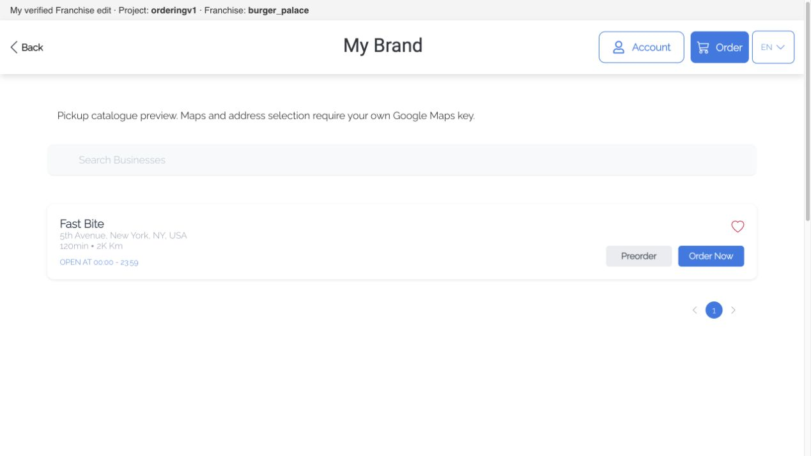

# Evidencia del onboarding de Franquicias

Verificado el 14 de octubre de 2026 en la rama `codex/sergio-137-product-onboarding`. La implementación inicial partió de `3d8820f`; se revalidó el árbol fusionado de `126b32d4e28319f01c4f9872caeea8157fdc5c1f` con `origin/main` en `cea1355496f67d1b6e4e57fecf8c24d93d4bac34`, antes de que la sesión principal cree el commit de merge. Esta evidencia distingue comandos, pruebas sintéticas y comprobación de navegador. Esta implementación no cambia el backend.

| Comprobación | Resultado | Evidencia |
| --- | --- | --- |
| Runtime | Node 24.21.0, pnpm 9.15.0 | `.nvmrc`, `packageManager`, wrappers `scripts/check-node.cjs` |
| Instalación | PASS frozen | `HUSKY=0 pnpm install --frozen-lockfile`; resolución omitida, lockfile sin diff |
| Build | PASS | `pnpm build`; avisos existentes de ciclos entre chunks y tamaño superior a 500 kB |
| Lint | PASS | `pnpm lint:check`; se corrigieron además tres comillas preexistentes de dos tests sin cambiar sus assertions |
| i18n | PASS | `pnpm i18n:verify`: 1104 claves; `pnpm i18n:check-generated`: coincide con escaneo |
| Helper común y adapter real | PASS, 32 tests | `pnpm setup:test`; fixtures temporales, no backend real ni configuración del checkout |
| Runtime seleccionado | PASS, 46 tests / 6 archivos | Scope A/B no destructivo, SDK original, ID numérico y consumidores root/home/cart/productos/checkout |
| Suite completa + cobertura | PASS, 256 archivos / 781 tests | `pnpm test:coverage` terminó con exit 0 tras las correcciones de scope, ID, push y navegación local |
| Cobertura estricta | PASS, 77.81% / umbral 70% | `node scripts/coverage-summary.js --no-run --strict`; inventario de 253 fuentes con tests, no todo el código |
| Preview sin push y catálogo público | PASS, 12 tests / 5 archivos | No cola/SDK OneSignal local, Firebase sin permission/worker/token, badge local y navegación sin guest save; producción conserva el flujo de invitado |
| Catálogo sin Maps ni dirección | PASS, 28 tests / 5 archivos | Defaults públicos preparados antes de proveedores; parámetros de lectura pickup/location; opciones personales intactas; sin autoactivar tienda |
| Layout del catálogo local | PASS en navegador real | Título de tarjeta: x=94.5, y=342.5, ancho=648 en viewport de 1269 px; captura del catálogo visible |
| Datos protegidos | Plantilla, lockfile y licencia conservados; SDK actualizado desde main | Sin diff de `src/config.json`, `pnpm-lock.yaml`, `.gitmodules` o `license-ordering.txt` durante la revalidación; índice y checkout del SDK coinciden en `e1222c32a8eaeb6999ab1df52cb10dfa844d7888`, igual que main |
| Navegador con franquicia real | PASS en catálogo y HMR | Proyecto y franquicia elegidos explícitamente; tarjeta real visible y edición del indicador aplicada sin recarga |

## Revalidación al actualizar la base

La sesión principal preparó un merge sin conflictos de `origin/main` (`cea1355496f67d1b6e4e57fecf8c24d93d4bac34`) sobre la entrega publicada `126b32d4e28319f01c4f9872caeea8157fdc5c1f`. La base añade permisos de checkout de invitados por tipo de pedido, sus tests, la traducción correspondiente y el gitlink del SDK `e1222c32a8eaeb6999ab1df52cb10dfa844d7888`.

Se comprobaron ambas intenciones: el diff frente a main conserva los 43 archivos del onboarding; el diff frente a la punta anterior incorpora los 17 archivos de main, incluido el SDK fijado. No se resolvió ningún conflicto descartando un lado ni se editó ese código durante la revalidación. La plantilla quedó restaurada, sin diferencias locales ni en el índice. El SDK del checkout coincide exactamente con el gitlink del índice y con main.

Con Node 24.21.0 y pnpm 9.15.0: instalación frozen PASS sin nueva resolución, helper PASS (32 tests), suite con cobertura PASS (256 archivos, 781 tests), build PASS, lint PASS e i18n PASS (1104 claves y archivos generados coincidentes). El gate estricto dio 77.81% frente al umbral de 70%, sobre 253 fuentes con tests. Los checks no dejaron cambios en los archivos generados.

Las capturas siguientes documentan el catálogo y HMR comprobados antes de esta actualización de base. No sustituyen una comprobación del runtime con el SDK nuevo: la sesión principal realizará la prueba desde un clon anónimo después del commit de merge.

## Qué prueban los tests

El manifest del producto usa `persist:id`: el CLI recibe un slug explícito para la primera configuración y persiste su ID numérico, compatible con el SDK de producción. Una selección numérica ya configurada y del mismo proyecto puede reutilizarse. Si falta, no hace requests ni crea backup. Una selección sintética se guarda sólo tras el lookup filtrado por slug exacto y habilitado; el resto del JSON conserva todas sus propiedades. El adapter real verifica que `franchiseSlug` sea un número y el resumen público incluya su ID y slug. `doctor` confirma el proyecto/franquicia públicos, y `restore` recupera bytes exactos. Los tests comunes cubren respuesta inválida, mismatch, franquicia deshabilitada, confirmación de cambio, no-op, backup, atomicidad, restauración, symlinks y resumen de detección sin datos privados.

El runtime local fija API, socket, proyecto y franquicia ante inyección antigua, dominio y tema remoto. Antes de montar los proveedores se resuelve el slug elegido a un ID numérico positivo, exacto y habilitado para los filtros `franchise_id` del SDK. El snapshot conserva el selector original: el helper V2 persiste un ID numérico y el runtime acepta también un slug anterior. El slug humano resuelto se mantiene aparte para la etiqueta local. Todos los consumidores reciben el ID efectivo, incluidos home, direcciones, carrito, productos y checkout. La fachada de `localStorage` y `sessionStorage` aísla todas las llamadas del SDK y UI por API/versión/idioma/proyecto/franquicia, sin borrar datos globales ni namespaces A/B. `clear()` afecta sólo su propio namespace y la instalación falla cerrada si los getters no se pueden reemplazar. La tienda no monta los proveedores ni consulta datos hasta tener proyecto/franquicia en desarrollo. Producción conserva su resolución de dominio y worker.

## Navegador: catálogo y primera edición

La sesión principal comprobó `/search` con la selección explícita del proyecto y franquicia que muestra el indicador. La tarjeta real «Fast Bite» quedó dentro del viewport: su título tenía x=94.5, y=342.5 y ancho=648, frente a un viewport de 1269 px. Se verificó la imagen renderizada, además del árbol de accesibilidad; no se tomó la presencia de datos en ese árbol como prueba de visibilidad.

Después se cambió temporalmente el texto local del indicador a «My verified Franchise edit». HMR actualizó ese nodo sin recargar la página, conservando la selección visible. Esta captura del indicador registra el primer cambio comprobable; la sesión principal restaurará el texto y la configuración temporal antes de integrar.

## Límites

El catálogo i18n coincide con el código; conserva 44 slots vacíos existentes, 46 conflictos y 15 posibles typos informados por el generador. No se modificaron traducciones para esconder esos contadores. La suite de componentes emite avisos de React/jsdom existentes; un test verde no demuestra presentación visual.

Un endpoint público respondió con un listado de franquicias con `slug` y `enabled` boolean. Se inspeccionó únicamente el esquema y los slugs habilitados para pedir una selección; no se guardaron registros ni se cambió la plantilla. La detección local encontró un launcher conectado; eso no configura por sí mismo el frontend ni acredita la pertenencia del usuario por un GET público. El `doctor` contra la plantilla se rechazó sin escritura.

El catálogo local utiliza los tipos/ubicación públicos confirmados, exige pickup habilitado sin dirección y no inventa coordenadas. Se prepara una configuración de lectura separada de `options`, porque el SDK puede sincronizar ese almacenamiento al backend después de un login. Las pruebas confirman que no cambia `options` ni llama a `changeCityFilter`, y que no monta Maps ni activa automáticamente una tienda.

En preview local se omite push y la navegación inicial abre el catálogo público sin crear un invitado ni modificar opciones de pedido. El indicador local muestra proyecto y slug elegidos; producción no lo renderiza. No se verificaron checkout, pagos, notificaciones reales ni login de consumidores. La sesión principal verificó la apariencia del catálogo y la lectura de datos reales mediante las capturas anteriores. La selección de proyecto mediante navegador de Docs#70 sigue pendiente y corresponde únicamente al Marketplace; no se presenta como disponible en Franquicias.
